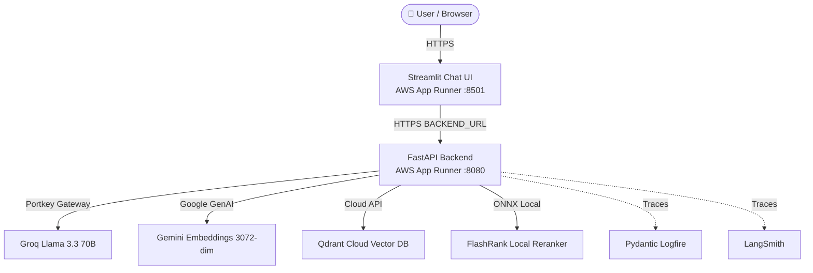

# AWS App Runner Deployment Guide: KnowledgeForge

This guide walks you through deploying **KnowledgeForge** (Enterprise Agentic RAG) to **AWS App Runner** — a fully managed, serverless container service with automatic TLS/HTTPS, autoscaling, and zero server maintenance.

---

## 🏛️ Architecture Overview



### Components
1. **Backend Service (`knowledgeforge-backend`)**:
   - Container running FastAPI + LangGraph + NeMo Guardrails + FlashRank on port **8080**.
   - Health check: `HTTP /health`
   - Serverless HTTPS endpoint provided by App Runner.
2. **Frontend Service (`knowledgeforge-ui`)**:
   - Container running Streamlit Chat UI on port **8501**.
   - Health check: `HTTP /_stcore/health`
   - Calls the backend via the `BACKEND_URL` environment variable.

---

## 📋 Prerequisites

Before deploying, ensure you have:
1. An active **AWS Account**.
2. **Docker Desktop** installed and running on your machine.
3. **AWS CLI** installed and configured:
   ```bash
   # On macOS
   brew install awscli

   # Configure AWS credentials
   aws configure
   ```
   Provide your `AWS Access Key ID`, `AWS Secret Access Key`, and default region (e.g., `us-east-1`).
4. An existing `.env` file in the `KnowledgeForge/` root containing your API keys (`GROQ_API_KEY`, `PORTKEY_API_KEY`, `QDRANT_API_KEY`, etc.).

---

## 🚀 Deployment Options

### Option 1: Automated Script (Recommended)

We provide an automated bash script that handles ECR creation, multi-platform building, pushing, IAM setup, and App Runner deployment:

```bash
# 1. Navigate to KnowledgeForge
cd /Users/rajvardhansrivastav/Desktop/enterprise_grade/KnowledgeForge

# 2. Make sure Docker Desktop is running

# 3. Run the automated deploy script
./scripts/deploy_aws.sh
```

**What the script does:**
1. Authenticates Docker with Amazon ECR.
2. Creates ECR repositories `knowledgeforge-backend` and `knowledgeforge-ui`.
3. Builds images with `--platform linux/amd64` (crucial for macOS Apple Silicon chips).
4. Pushes the images to ECR.
5. Sets up the IAM role `AppRunnerECRAccessRole`.
6. Creates or updates the Backend App Runner service with variables from `.env`.
7. Retrieves the generated Backend HTTPS URL.
8. Creates or updates the UI App Runner service with `BACKEND_URL=<backend-url>`.
9. Prints the live public URLs.

---

### Option 2: Step-by-Step Manual Deployment (CLI)

If you prefer executing each step manually:

#### 1. Set environment variables
```bash
export AWS_REGION="us-east-1"
export ACCOUNT_ID=$(aws sts get-caller-identity --query Account --output text)
export ECR_REGISTRY="${ACCOUNT_ID}.dkr.ecr.${AWS_REGION}.amazonaws.com"
```

#### 2. Create ECR repositories & authenticate Docker
```bash
# Create repositories
aws ecr create-repository --repository-name knowledgeforge-backend --region $AWS_REGION
aws ecr create-repository --repository-name knowledgeforge-ui --region $AWS_REGION

# Log in Docker to ECR
aws ecr get-login-password --region $AWS_REGION | docker login --username AWS --password-stdin $ECR_REGISTRY
```

#### 3. Build & push Docker images
> [!IMPORTANT]
> If building on an Apple Silicon (M1/M2/M3/M4) Mac, you **MUST** specify `--platform linux/amd64`. AWS App Runner compute instances run x86_64/amd64.

```bash
# Build & push Backend
docker buildx build --platform linux/amd64 -t $ECR_REGISTRY/knowledgeforge-backend:latest -f Dockerfile.backend . --push

# Build & push UI
docker buildx build --platform linux/amd64 -t $ECR_REGISTRY/knowledgeforge-ui:latest -f Dockerfile.ui . --push
```

#### 4. Create App Runner IAM access role
```bash
aws iam create-role --role-name AppRunnerECRAccessRole --assume-role-policy-document '{
    "Version": "2012-10-17",
    "Statement": [{"Effect": "Allow", "Principal": {"Service": "build.apprunner.amazonaws.com"}, "Action": "sts:AssumeRole"}]
}'

aws iam attach-role-policy --role-name AppRunnerECRAccessRole --policy-arn arn:aws:iam::aws:policy/service-role/AWSAppRunnerServicePolicyForECRAccess
```

#### 5. Deploy Backend on App Runner
Deploy the backend service via the AWS Management Console (App Runner → Create service → Container registry → ECR) or with the AWS CLI, configuring:
- **Image**: `<ACCOUNT_ID>.dkr.ecr.<AWS_REGION>.amazonaws.com/knowledgeforge-backend:latest`
- **Port**: `8080`
- **Health check path**: `/health`
- **CPU / Memory**: `1 vCPU, 2 GB`
- **Environment variables**:
  - `PORT=8080`
  - `GROQ_API_KEY=<your_key>`
  - `PORTKEY_API_KEY=<your_key>`
  - `QDRANT_API_KEY=<your_key>`
  - `QDRANT_CLUSTER_ENDPOINT=<your_url>`
  - `GEMINI_API_KEY=<your_key>`
  - `LOGFIRE_TOKEN=<your_token>`
  - `LANGSMITH_API_KEY=<your_key>`

Note down the public URL output: e.g. `https://xxxxxx.us-east-1.awsapprunner.com`.

#### 6. Deploy UI on App Runner
Deploy the UI service with:
- **Image**: `<ACCOUNT_ID>.dkr.ecr.<AWS_REGION>.amazonaws.com/knowledgeforge-ui:latest`
- **Port**: `8501`
- **Health check path**: `/_stcore/health`
- **CPU / Memory**: `1 vCPU, 2 GB`
- **Environment variables**:
  - `PORT=8501`
  - `BACKEND_URL=https://xxxxxx.us-east-1.awsapprunner.com` (from step 5)
  - `LOGFIRE_TOKEN=<your_token>`

---

### Option 3: AWS CloudFormation

A complete CloudFormation template is located at [aws/cloudformation.yaml](file:///Users/rajvardhansrivastav/Desktop/enterprise_grade/KnowledgeForge/aws/cloudformation.yaml).

```bash
aws cloudformation create-stack \
  --stack-name knowledgeforge-stack \
  --template-body file://aws/cloudformation.yaml \
  --capabilities CAPABILITY_NAMED_IAM \
  --parameters \
      ParameterKey=GroqApiKey,ParameterValue="<YOUR_KEY>" \
      ParameterKey=PortkeyApiKey,ParameterValue="<YOUR_KEY>" \
      ParameterKey=QdrantApiKey,ParameterValue="<YOUR_KEY>" \
      ParameterKey=QdrantClusterEndpoint,ParameterValue="<YOUR_URL>" \
      ParameterKey=GeminiApiKey,ParameterValue="<YOUR_KEY>" \
      ParameterKey=LogfireToken,ParameterValue="<YOUR_TOKEN>"
```

---

### Option 4: Automated CI/CD via GitHub Actions

A ready-to-use GitHub Actions workflow is located at [.github/workflows/deploy-aws.yml](file:///Users/rajvardhansrivastav/Desktop/enterprise_grade/KnowledgeForge/.github/workflows/deploy-aws.yml).

To enable it:
1. Push your repository to GitHub.
2. In GitHub → **Settings** → **Secrets and variables** → **Actions**, add:
   - `AWS_ACCESS_KEY_ID`
   - `AWS_SECRET_ACCESS_KEY`
3. Every commit pushed to `main` will automatically build amd64 images, push them to ECR, and trigger an App Runner deployment!

---

### Option 5: Local Multi-Container Testing (Docker Compose)

Before deploying to the cloud, test both services locally in Docker:

```bash
docker compose up --build
```
- FastAPI Backend: `http://localhost:8080` (Docs: `http://localhost:8080/docs`)
- Streamlit UI: `http://localhost:8501`

---

## 🔍 Verification & Health Checks

Once deployed, verify the endpoints:

### 1. Test Backend Health
```bash
curl https://<backend-apprunner-url>/health
# Expected Response: {"status":"healthy"}
```

### 2. Test Backend Query
```bash
curl -X POST https://<backend-apprunner-url>/query \
  -H "Content-Type: application/json" \
  -d '{"q": "What is the architecture of KnowledgeForge?", "thread_id": "test_user"}'
```

### 3. Access Streamlit Chat UI
Open `https://<ui-apprunner-url>` in any web browser to interact with the agentic assistant.

---

## 💡 Best Practices & Cost Optimization

1. **Auto-scaling Configuration**:
   - Default App Runner auto-scaling policy:
     - Min instances: 1
     - Max instances: 25
     - Concurrency per instance: 100
   - For low traffic / staging, set Max instances to `2` to prevent unexpected costs.
2. **Pausing Services**:
   - You can pause App Runner services at any time via `aws apprunner pause-service --service-arn <ARN>` (or via the AWS Console). Paused services incur **zero compute cost** (only minimal storage for container images in ECR).
3. **Custom Domains**:
   - Under App Runner → **Custom domains**, you can bind your company domain (e.g. `chat.yourdomain.com`) with automated AWS ACM SSL certificates.
